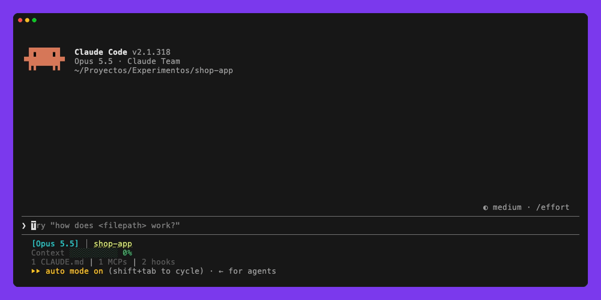
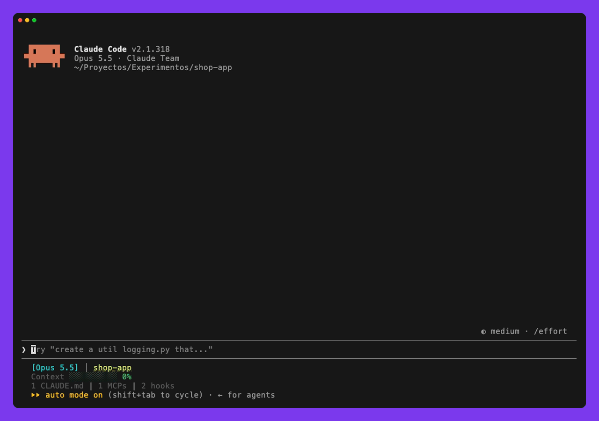
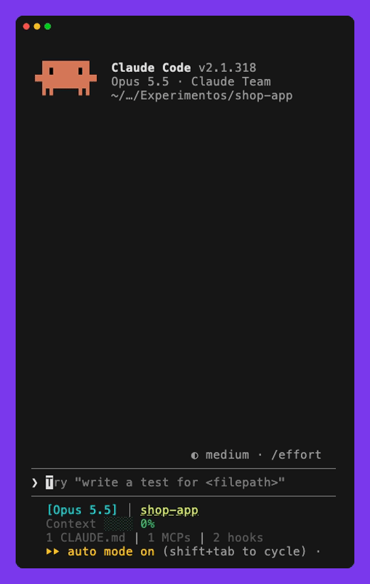

<p align="right"><a href="README.md">English</a> · <b>Español</b></p>

<p align="center">
  
</p>

<p align="center">
  
  
  <a href="https://github.com/diegoperezg7/prompt-coach/actions/workflows/test.yml"></a>
  
  
  
</p>

<p align="center">
  <b>Mod de Claude Code</b> que puntúa el borrador del prompt contra una rúbrica real y lo reescribe antes de enviarlo.<br>
  Eliges el modelo, el idioma y lo detallada que es la propuesta.<br>
  Nunca envía nada por su cuenta: siempre eliges tú.
</p>

<p align="center">
  <b>Comprobado en sesiones reales de Claude Code:</b> la nota en vivo sube de 5 a 75 cuando el borrador gana ruta, comportamiento esperado, un test y una restricción.<br>
  <code>/coach</code> lleva un borrador de una línea sobre un login que devuelve 500 de 33 a 90 y pregunta el único dato que no puede inventar (qué archivo); en la demo de abajo, la respuesta lo lleva a 100.<br>
  <code>/coach stats</code> responde con la media de esta semana frente a la anterior y el criterio que más te falta.
</p>

---

## La nota, mientras escribes

Una banda sobre el compositor puntúa cada tecla: ámbar por debajo de 60, verde a partir de ahí. Aquí pasa de **5** a **75** al añadir ruta, comportamiento esperado, un test y una restricción, y desde 60 columnas la banda dice lo que más resta todavía (aquí, el formato de respuesta).

<p align="center"></p>

## Mejorar con un comando

Desde 60 columnas la banda nombra además el criterio que más resta. `/coach` (o el botón de la banda) reescribe el borrador con el modelo que elijas (Haiku por defecto) usando la conversación reciente y abre un panel con la propuesta. Desde ahí puedes sustituir el borrador (el panel se cierra, y `/coach undo` te devuelve el tuyo), copiarlo o cancelar; cuando falta un dato que solo tú sabes (el archivo, el error literal), el panel te pide solo ese y mejora otra vez con tu respuesta. `/coach stats` enseña la media de esta semana frente a la anterior y el criterio que más te falta. Grabación real: el borrador no dice el archivo, así que la propuesta se queda en **93** y lo pregunta; con la respuesta, **100**.

<p align="center"></p>

## Cómo funciona

<p align="center"></p>

## Una nota honesta

<p align="center"></p>

| Criterio | Puntos | Cuenta si |
|---|---|---|
| Objetivo | 20 | hay un verbo de encargo y un objeto (seis palabras o una ruta), o una pregunta concreta; la longitud sola no cuenta |
| Contexto | 15 | hay ruta, archivo, `símbolo` o @mención **que aparece en el borrador o la conversación** |
| Detalle | 15 | dos datos concretos: actual y esperado, error, ejemplo, cifra, adjunto |
| Criterio de aceptación | 20 | dice cómo se comprueba que está hecho: una prueba, un resultado observable o una cifra (12 si solo pide verificar); la cabecera sola no cuenta |
| Restricciones | 15 | dos límites reales («no cambies la API», «solo toca auth»); ni la cabecera ni un «solo, nunca» suelto cuentan |
| Formato de respuesta | 10 | dice qué devolver |
| Claridad | 5 | sin «esto», «lo de», «algo» ni huecos `[...]` |

- **No se infla.** Una ruta que el modelo se inventa no puntúa, rellenar con palabras clave sin contenido saca nota floja, y el prompt de reescritura le prohíbe afirmar datos del proyecto que no consten. 26 casos de regresión en seis idiomas lo vigilan (`core/rubric.fixtures.ts`).
- **Un 100 se gana.** Solo llega cuando el borrador o la conversación traen la ubicación y los datos. Sin ellos la propuesta se queda en 86-93, pide al agente que lo averigüe y el panel dice qué falta: `Falta para 100: contexto 8/15`.

## Se adapta a cualquier terminal

<table>
  <tr>
    <td width="44%"></td>
    <td>
      <ul>
        <li><b>Estrecho</b> (menos de 40 columnas): la banda deja solo la nota y el botón.</li>
        <li><b>Bajo</b>: los botones suben encima del editor, que mide lo que queda libre (3 a 14 filas), y lo que falta para 100 pasa a formato corto.</li>
        <li><b>Ancho</b>: el panel se acopla al lado del transcript.</li>
        <li><b>Sin sitio para el panel</b>: <code>/coach</code> devuelve la propuesta en el propio transcript.</li>
        <li>Ghostty, iTerm, Terminal.app y el terminal integrado de VS Code: es Claude Code quien pinta la interfaz, así que el mod funciona igual en todos.</li>
      </ul>
    </td>
  </tr>
</table>

## Haiku, Sonnet u Opus

<p align="center"></p>

16 borradores reales en seis idiomas (`bench/cases.mts`), el mismo flujo que el mod y un juez Opus ciego que puntúa fidelidad, datos inventados, utilidad y si la propuesta sale en el idioma del borrador:

| Modelo | Nota media | A 100 | Inventados | Utilidad | Idioma correcto | Coste por mejora | Latencia |
|---|---|---|---|---|---|---|---|
| **Haiku** (por defecto) | 93,4 | 4/16 | 6 | 7,5/10 | 16/16 | **0,00055 $** | **3,8 s** |
| Sonnet | 93,5 | 4/16 | 6 | 7,9/10 | 16/16 | 0,0111 $ | 5,4 s |
| Opus | 94,8 | 5/16 | 4 | 8,0/10 | 16/16 | 0,0239 $ | 7,5 s |

Opus escribe propuestas algo más útiles a 43 veces el coste de Haiku; lo eliges tú con la opción `model`. Se repite con `node --experimental-strip-types bench/run.mts haiku,sonnet,opus opus balanced`; las notas que respaldan estas tablas están en [`bench/summary.json`](bench/summary.json).

## Texto pegado y dictado

Un pegado largo sale en el compositor como `[Pasted text #1 +12 lines]`, y lo mismo el dictado de herramientas como Wispr Flow, que escribe pegando. Claude Code solo le da ese texto a un mod al pulsar Enter, así que:

- **Mientras escribes**, la banda no puntúa el marcador: avisa de que lo pegado se lee al pulsar Enter, o de que pegarlo otra vez lo expande para puntuarlo ya.
- **Al pulsar Enter**, un prompt flojo con texto pegado se retiene y el panel enseña una propuesta hecha con el contenido completo (con `holdPasted`, activada por defecto). Si no escribiste nada más, lo pegado es el encargo (un dictado) y se reescribe como tal. Si escribiste algo alrededor, lo pegado es material de apoyo (un log, un trozo de código): el modelo lo lee para concretar el encargo y la propuesta lo lleva entero. *Enviar original* manda tu texto sin tocar.
- **Las imágenes** se conservan en la propuesta y cuentan como dato concreto, pero el mod no puede verlas: llama al modelo solo con texto.

## Lo que cuesta cada mejora

El panel enseña lo que gastó cada mejora, por ejemplo `haiku · 2 llamadas · 3100 in · 1200 out · plan <0,1 % · 0,0006 $ API · 6,1 s`, y `/coach usage` enseña tu plan en este momento (`5 h 24,0 % (se reinicia 4/11 18:50) · 7 días 70,0 %`), los totales de hoy y de los últimos 7 días, por modelo, y las últimas llamadas una a una (se guardan 90 días).

- **Tokens**: salen tal cual de cada llamada.
- **Parte del plan**: lo que cada llamada movió las ventanas de tu plan (5 horas, 7 días), leídas antes y después. Es lo que cuenta con un plan de suscripción, y la misma mejora pesa distinto en cada plan. Claude Code lo da con un decimal, así que una mejora por debajo del 0,1 % sale como `<0,1 %`, no como 0. En una sesión real, tres mejoras con Opus no movieron la ventana de 5 horas ni un 0,1 %.
- **Dólares**: son el equivalente a precio de lista de la API (`core/pricing.ts`), no un cargo: con un plan no se paga por llamada. La fórmula coincide hasta el último decimal con la cifra de Claude Code para Haiku 5.5 y Sonnet 5.5. `/cost` no incluye las llamadas del mod, así que este es el sitio para comprobarlas.

## Instalar

Desde el prompt de Claude Code:

```
/plugin install prompt-coach --marketplace diegoperezg7/prompt-coach
```

Responde `y` para añadir el marketplace y elige el ámbito de usuario: así funciona en el terminal y en la extensión de VS Code, que comparten los plugins del usuario. Desde un shell: `claude plugin install prompt-coach --marketplace diegoperezg7/prompt-coach`.

## Ajustes

Cinco opciones en `/plugin`, Prompt Coach, configurar:

| Opción | Valores | Por defecto |
|---|---|---|
| `model` | `haiku`, `sonnet`, `opus`, o `session` para el modelo de la propia sesión: el modelo que reescribe | `haiku` |
| `language` | `auto`, `en`, `es`, `fr`, `de`, `pt`, `it`: idioma de la interfaz; `auto` sigue al borrador | `auto` |
| `verbosity` | `concise`, `balanced`, `detailed`: longitud de la propuesta | `balanced` |
| `projectRules` | leer `CLAUDE.md` y `AGENTS.md` del proyecto (hasta 4000 caracteres) para que las restricciones salgan de las reglas del repo | activada |
| `holdPasted` | retener al pulsar Enter un prompt flojo con texto pegado, en cualquier superficie, y proponer una reescritura hecha con su contenido completo (ver abajo) | activada |

La rúbrica entiende borradores en los seis idiomas, y la propuesta se escribe siempre en el idioma del borrador. La verbosidad, medida con Haiku sobre los 16 borradores:

| Verbosidad | Palabras de media | Nota media | Utilidad |
|---|---|---|---|
| `concise` | 101 | 89,5 | 7,9/10 |
| `balanced` | 247 | 93,4 | 7,5/10 |
| `detailed` | 332 | 93,4 | 7,8/10 |

Con menos texto caben menos restricciones y detalles, así que la nota baja un poco; el juez las ve igual de útiles.

## Codex

Prompt Coach también funciona en Codex, con la misma rúbrica (`core/`), a través de una CLI pequeña (`cli/prompt-coach.mts`, Node 22.6 o posterior):

```
git clone https://github.com/diegoperezg7/prompt-coach && sh prompt-coach/adapters/codex/install.sh
```

- **Hook**: un encargo flojo se retiene con su nota y lo que falta para 100. Empieza el prompt con `raw:` para enviarlo tal cual. Codex no ejecuta un hook nuevo hasta que lo apruebas en `/hooks`.
- **Skill `$coach`**: reescribe el borrador con el modelo de la sesión y comprueba la nota con la CLI.
- Sin banda en vivo ni panel: Codex no deja a una extensión dibujar en el compositor.

## Por superficie

| Superficie | Puntuación en vivo | Botón | Retención en Enter |
|---|---|---|---|
| Terminal y app de escritorio | a cada tecla | banda (`m`) y `/coach` | solo prompts con texto pegado (`holdPasted`) |
| Extensión de VS Code | sondeo del compositor cada segundo (la extensión no envía las teclas) | banda y `/coach` | sí: un prompt flojo de trabajo se retiene y abre el panel; los sólidos, las preguntas, los comandos y los mensajes con adjuntos pasan |

## Desarrollo

```
claude --plugin-dir .        # cargar sin instalar
claude plugin test .         # tests: terminal, escritorio y VS Code, anchos y altos, idiomas, ajustes
claude plugin validate .
```

| Fichero | Qué hay |
|---|---|
| `core/rubric.ts` | rúbrica, prompts del modelo y motor local, sin dependencias de Claude Code |
| `hooks/register.tsx` | conecta los eventos del motor |
| `hooks/state.ts`, `hooks/actions.ts`, `hooks/views.tsx` | estado y ajustes, acciones (mejorar, aplicar, cancelar, historial), banda y panel |
| `hooks/i18n.ts` | textos de la interfaz en seis idiomas |
| `hooks/usage.ts`, `core/pricing.ts` | tokens y coste de cada llamada al modelo, `/coach usage` |
| `core/rubric.fixtures.ts` | casos de regresión de la rúbrica en seis idiomas |
| `cli/`, `adapters/codex/` | la CLI y el hook y la skill de Codex |
| `hooks/coach.test.tsx` | tests con el kit `claude-code/testing` |
| `bench/` | benchmark de modelos con juez ciego |
| `types/index.d.ts` | contrato del estado del mod |
| `CHANGELOG.md` | historial de versiones (en inglés) |
| `assets/demo.mp4` | vídeo de 35 s en inglés, listo para compartir |

## Licencia

MIT
