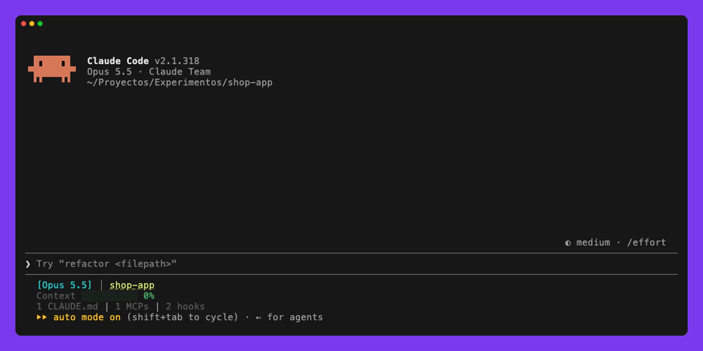
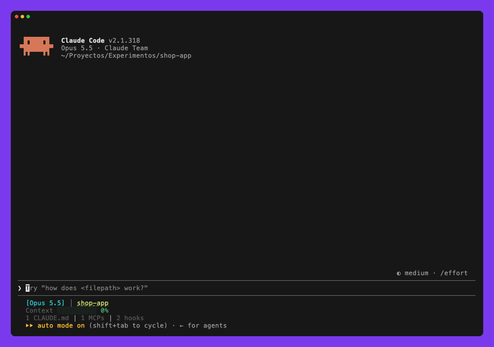
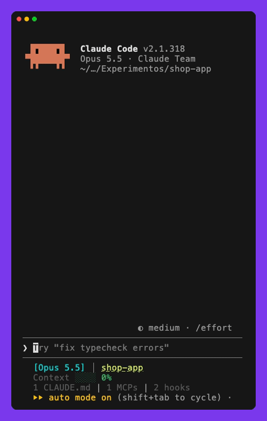

<p align="right"><b>English</b> · <a href="README.es.md">Español</a></p>

<p align="center">
  
</p>

<p align="center">
  
  
  <a href="https://github.com/diegoperezg7/prompt-coach/actions/workflows/test.yml"></a>
  
  
  
</p>

<p align="center">
  A <b>Claude Code mod</b> that scores your prompt draft against a real rubric and rewrites it before you send it.<br>
  Pick the model, the language and how verbose the proposal is.<br>
  It never sends anything on its own: you always choose.
</p>

<p align="center">
  <b>Checked in real Claude Code sessions:</b> the live score climbs from 5 to 75 as a draft gains a path, the expected behaviour, a test and a constraint.<br>
  <code>/coach</code> takes a one-line draft about a login that returns 500 from 33 to 90 and asks for the one fact it cannot invent (which file); in the demo below, the answer takes it to 100.<br>
  <code>/coach stats</code> answers with this week's average against the previous one and the criterion you miss most.
</p>

---

## Your score, as you type

A band above the composer scores every keystroke: amber below 60, green from there on. Here it climbs from **5** to **75** as the draft gains a file path, the expected behaviour, a test and a constraint, and from 60 columns the band names what still costs the most (here, the response format).

<p align="center"></p>

## Improve it with one command

From 60 columns the band also names the criterion that costs the most. `/coach` (or the band's button) rewrites the draft with the model you chose (Haiku by default), using the recent conversation, and opens a pane with the proposal. From there you can replace the draft, undo, improve again, copy or cancel; when a fact only you know is missing (the file, the exact error), the pane asks for just that and improves again with your answer. `/coach stats` shows this week's average against the previous one and the criterion you miss most. Real recording: the draft has no file, so the proposal stops at **93** and asks for it; with the answer, **100**.

<p align="center"></p>

## How it works

<p align="center"></p>

## An honest score

<p align="center"></p>

| Criterion | Points | Counts when |
|---|---|---|
| Goal | 20 | there is a task verb and an object (six words or a path), or a concrete question; length alone does not count |
| Context | 15 | there is a path, file, `symbol` or @mention **that appears in the draft or the conversation** |
| Detail | 15 | two concrete facts: current and expected behaviour, error, example, figure, attachment |
| Acceptance criteria | 20 | it says how to check it is done: a test, an observable result or a figure (12 if it only asks to verify); the header alone does not count |
| Constraints | 15 | two real limits ("do not change the API", "only touch auth"); the header or a bare "only, never" does not count |
| Response format | 10 | it says what to return |
| Clarity | 5 | no "this thing", "stuff" or `[...]` gaps |

- **No inflation.** A path the model invents scores nothing, keyword stuffing without content scores weak, and the rewrite prompt forbids stating project facts that are not given. 26 regression cases in six languages keep it that way (`core/rubric.fixtures.ts`).
- **A 100 is earned.** It only comes when the draft or the conversation brings the location and the facts. Without them the proposal stays at 86-93, tells the agent to find out, and the pane says what is missing: `Missing for 100: context 8/15`.

## Fits any terminal

<table>
  <tr>
    <td width="44%"></td>
    <td>
      <ul>
        <li><b>Narrow</b> (under 40 columns): the band keeps only the score and the button.</li>
        <li><b>Short</b>: the buttons move above the editor, which takes the rows left over (3 to 14), and what is missing for 100 turns compact.</li>
        <li><b>Wide</b>: the pane docks beside the transcript.</li>
        <li><b>No room for the pane</b>: <code>/coach</code> returns the proposal in the transcript itself.</li>
        <li>Ghostty, iTerm, Terminal.app and the VS Code integrated terminal: Claude Code draws the interface, so the mod behaves the same in all of them.</li>
      </ul>
    </td>
  </tr>
</table>

## Haiku, Sonnet or Opus

<p align="center"></p>

16 real drafts in six languages (`bench/cases.mts`), the same flow as the mod and a blind Opus judge scoring fidelity, invented facts, usefulness and whether the proposal stays in the draft's language:

| Model | Avg score | At 100 | Invented | Usefulness | Right language | Cost per rewrite | Latency |
|---|---|---|---|---|---|---|---|
| **Haiku** (default) | 93.4 | 4/16 | 6 | 7.5/10 | 16/16 | **$0.00055** | **3.8 s** |
| Sonnet | 93.5 | 4/16 | 6 | 7.9/10 | 16/16 | $0.0111 | 5.4 s |
| Opus | 94.8 | 5/16 | 4 | 8.0/10 | 16/16 | $0.0239 | 7.5 s |

Opus writes slightly more useful proposals at 43x the cost of Haiku; the choice is yours with the `model` setting. Rerun it with `node --experimental-strip-types bench/run.mts haiku,sonnet,opus opus balanced`; the scores behind these tables are in [`bench/summary.json`](bench/summary.json).

## What each rewrite costs

The pane shows the tokens and cost of every rewrite, for example `haiku · 2 calls · 3100 in · 1200 out · $0.0006 · 6.1 s`, and `/coach usage` lists today's and the last 7 days' totals, per model, and the last calls one by one (kept for 90 days). Tokens come straight from each call; cost is computed at API list price (`core/pricing.ts`), and the formula matches Claude Code's own figure for Haiku 5.5 and Sonnet 5.5 to the last digit. `/cost` does not include the mod's calls, so this is the place to check them.

## Install

From the Claude Code prompt:

```
/plugin install prompt-coach --marketplace diegoperezg7/prompt-coach
```

Answer `y` to add the marketplace and pick the user scope: it then works in the terminal and in the VS Code extension, which share user plugins. From a shell: `claude plugin install prompt-coach --marketplace diegoperezg7/prompt-coach`.

## Settings

Four options in `/plugin`, Prompt Coach, configure:

| Option | Values | Default |
|---|---|---|
| `model` | `haiku`, `sonnet`, `opus`, or `session` for the session's own model: the model that rewrites | `haiku` |
| `language` | `auto`, `en`, `es`, `fr`, `de`, `pt`, `it`: interface language; `auto` follows the draft | `auto` |
| `verbosity` | `concise`, `balanced`, `detailed`: length of the proposal | `balanced` |
| `projectRules` | read the project's `CLAUDE.md` and `AGENTS.md` (up to 4000 characters) so constraints come from the repo's own rules | on |

The rubric reads drafts in all six languages, and the proposal is always written in the draft's language. Verbosity, measured with Haiku over the 16 drafts:

| Verbosity | Avg words | Avg score | Usefulness |
|---|---|---|---|
| `concise` | 101 | 89.5 | 7.9/10 |
| `balanced` | 247 | 93.4 | 7.5/10 |
| `detailed` | 332 | 93.4 | 7.8/10 |

Shorter proposals leave less room for constraints and detail, so they score a little lower; the judge finds them just as useful.

## Codex

Prompt Coach also runs in Codex, on the same rubric (`core/`), through a small CLI (`cli/prompt-coach.mts`, Node 22.6 or later):

```
git clone https://github.com/diegoperezg7/prompt-coach && sh prompt-coach/adapters/codex/install.sh
```

- **Hook**: a weak work prompt is held with its score and what is missing for 100. Start a prompt with `raw:` to send it as it is. Codex skips new hooks until you trust them in `/hooks`.
- **`$coach` skill**: rewrites the draft with the session's model and checks the score with the CLI.
- No live score band or proposal pane: Codex does not let an extension draw in the composer.

## Surfaces

| Surface | Live score | Button | Hold on Enter |
|---|---|---|---|
| Terminal and desktop app | every keystroke | band (`m`) and `/coach` | no |
| VS Code extension | polls the composer every second (the extension does not send keystrokes) | band and `/coach` | yes: a weak work prompt is held and opens the pane; solid prompts, questions, commands and messages with attachments go through |

## Development

```
claude --plugin-dir .        # load without installing
claude plugin test .         # tests: terminal, desktop and VS Code, widths and heights, languages, settings
claude plugin validate .
```

| File | What it holds |
|---|---|
| `core/rubric.ts` | rubric, model prompts and local engine, with no Claude Code dependency |
| `hooks/register.tsx` | wires the engine's events |
| `hooks/state.ts`, `hooks/actions.ts`, `hooks/views.tsx` | state and settings, actions (rewrite, apply, cancel, history), band and pane |
| `hooks/i18n.ts` | interface texts in six languages |
| `hooks/usage.ts`, `core/pricing.ts` | tokens and cost of every model call, `/coach usage` |
| `core/rubric.fixtures.ts` | regression cases for the rubric in six languages |
| `cli/`, `adapters/codex/` | the CLI and the Codex hook and skill |
| `hooks/coach.test.tsx` | tests with the `claude-code/testing` kit |
| `bench/` | model benchmark with a blind judge |
| `types/index.d.ts` | the mod's state contract |
| `CHANGELOG.md` | version history |
| `assets/demo.mp4` | 35 s demo video, ready to share |

## License

MIT
